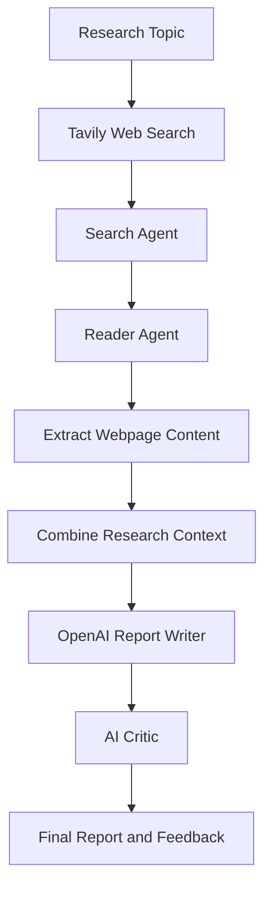

# 🔬 ResearchMind — Multi-Agent AI Research System

An AI-powered research application that searches the web, extracts relevant webpage content, generates structured research reports, and evaluates the generated draft using an AI critic. Built with Python, LangChain, OpenAI, Tavily Search, and Streamlit.

## 🚀 Features

- 🔎 **Web Search Agent:** Finds relevant web results using the Tavily Search API.
- 📖 **Reader Agent:** Extracts readable text from a selected webpage.
- ✍️ **AI Report Writer:** Generates a structured report using OpenAI's `gpt-4o-mini` model.
- 🧠 **AI Critic:** Evaluates the generated report and provides a score, strengths, improvements, and a verdict.
- 🖥️ **Streamlit Interface:** Run research interactively and inspect intermediate outputs.
- 📥 **Download Reports:** Download the final research report in Markdown format.
- 💻 **CLI Support:** Run the research pipeline directly from the terminal.

## 🏗️ Architecture



## 🛠️ Tech Stack

| Technology | Purpose |
|---|---|
| Python | Core programming language |
| Streamlit | Interactive web interface |
| LangChain | Agent and LLM orchestration |
| OpenAI API | Research report generation and critique |
| GPT-4o mini | Configured language model |
| Tavily Search API | Web search |
| Requests | HTTP requests |
| Beautiful Soup | HTML text extraction |
| python-dotenv | Environment variable management |

## 📂 Project Structure

```text
Multi-agent-research-system-main/
├── app.py              # Streamlit application
├── agents.py           # Agents, writer, and critic
├── tools.py            # Search and scraping tools
├── pipeline.py         # Command-line pipeline
├── requirements.txt    # Python dependencies
├── .env.example        # API key template
├── .gitignore          # Git exclusions
└── README.md           # Project documentation
```

## ⚙️ Installation and Setup

### Prerequisites

- Python 3.10 or newer
- OpenAI API key
- Tavily API key
- Internet connection

### 1. Clone the repository

Replace the placeholder with your actual GitHub repository URL.

```bash
git clone <YOUR_GITHUB_REPOSITORY_URL>
cd Multi-agent-research-system-main
```

Alternatively, download the repository ZIP and open the extracted folder in VS Code.

### 2. Create a virtual environment

**Windows PowerShell**

```powershell
py -3.11 -m venv .venv
.\.venv\Scripts\Activate.ps1
```

If Python 3.11 is unavailable, use an installed compatible Python version.

**macOS / Linux**

```bash
python3 -m venv .venv
source .venv/bin/activate
```

### 3. Install dependencies

```bash
python -m pip install --upgrade pip
python -m pip install -r requirements.txt
```

### 4. Configure environment variables

Create a `.env` file in the project root using `.env.example` as a template.

Add your API keys:

```dotenv
OPENAI_API_KEY=your_openai_api_key
TAVILY_API_KEY=your_tavily_api_key
```

Obtain API keys from:

- OpenAI: https://platform.openai.com/api-keys
- Tavily: https://app.tavily.com/

**Security:** Never upload your `.env` file or expose API keys in a public repository.

### 5. Run the Streamlit application

```bash
python -m streamlit run app.py
```

Open the local URL displayed in the terminal, usually:

http://localhost:8501

Enter a research topic and start the research pipeline.

### 6. Run from the terminal

To execute the command-line pipeline:

```bash
python pipeline.py
```

Follow the terminal prompts to enter a research topic.

## 🧪 Example Research Topics

Try researching topics such as:

- Recent developments in Generative AI
- Multi-agent AI systems and agent orchestration
- Retrieval-Augmented Generation (RAG)
- Large Language Models and their applications
- AI-powered research automation
- Emerging trends in machine learning

These are example inputs, not pre-generated research results.

## 📄 Generated Output

The report writer is prompted to produce:

- Introduction
- Key Findings
- Conclusion
- Sources

The critic provides:

- Score out of 10
- Strengths
- Areas for improvement
- Overall verdict

The actual output depends on the retrieved content, model response, and external API availability.

## 🔧 Configuration

The language model is configured in `agents.py`:

```python
llm = ChatOpenAI(
    model="gpt-4o-mini",
    temperature=0
)
```

The current search workflow requests up to five search results. The webpage extraction tool uses a request timeout and limits the extracted text.

Modify these settings in the relevant source files if your use case requires different behavior.

## 🐛 Troubleshooting

### Missing API key

Verify that `.env` exists in the project root and contains valid credentials.

Restart the application after updating environment variables.

### OpenAI authentication or quota errors

Check your API key, API access, billing configuration, and usage limits.

### Tavily search errors

Verify the Tavily API key and check the service's usage limits.

### Streamlit command not found

Run Streamlit through Python:

```bash
python -m streamlit run app.py
```

### ModuleNotFoundError

Activate the correct virtual environment and reinstall dependencies:

```bash
python -m pip install -r requirements.txt
```

### Webpage extraction fails

Some websites block automated requests or require JavaScript. Try a different webpage or research source.

## ⚠️ Limitations

- Research depends on external APIs and website availability.
- Scraped webpage content may be incomplete.
- AI-generated reports can contain inaccurate or unsupported claims.
- The critic's score is an AI-generated assessment, not an objective benchmark.
- The current implementation does not guarantee independent verification of every claim.
- Automated tests and persistent research history are not included in the supplied implementation.

Always verify important claims using the original sources before publishing or relying on the report.

## 🔐 Security and Responsible Use

- Keep API keys private.
- Never commit `.env` files or credentials.
- Respect website terms, rate limits, and applicable copyright requirements.
- Treat retrieved webpage content as untrusted input.
- Independently review reports used for important decisions.

## 🚀 Future Improvements

- Add automated unit and integration tests.
- Improve source attribution and claim-level citations.
- Add retry handling and structured error reporting.
- Support configurable LLMs and search settings.
- Add PDF and DOCX report exports.
- Store research history and allow previous reports to be reviewed.
- Evaluate report quality against trusted reference sources.

## 🤝 Contributing

Contributions, bug reports, and feature suggestions are welcome.

1. Fork the repository.
2. Create a feature branch.
3. Make your changes.
4. Test the updated functionality.
5. Submit a pull request describing your changes.

Never include API credentials or private information in a contribution.

## 📜 License

No license file was included in the supplied project. Unless a license is added, do not assume that others have permission to reuse or redistribute the code.

## 📚 Documentation

- [LangChain Agents](https://docs.langchain.com/oss/python/langchain/agents)
- [LangChain OpenAI Integration](https://python.langchain.com/docs/integrations/chat/openai/)
- [Tavily Documentation](https://docs.tavily.com/)
- [Streamlit Documentation](https://docs.streamlit.io/)

---

**Built with Python, LangChain, OpenAI, Tavily, and Streamlit.**
